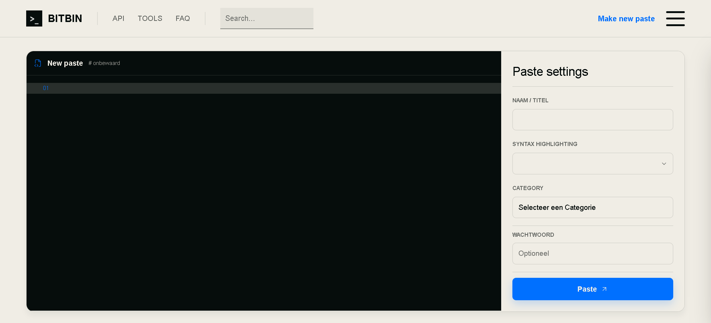

# BitBin

## Inhoudsopgave

- [BitBin](#bitbin)
    - [Inhoudsopgave](#inhoudsopgave)
    - [Versiebeheer](#versiebeheer)
    - [Ons Project](#ons-project)
        - [Versie 1](#versie-1--20261005)
    - [De Opdrachtgever](#de-opdrachtgever)
    - [Functionaliteiten](#functionaliteiten-van-bitbin)
        - [Code Opslaan & Delen](#code-opslaan--delen)
        - [Code Highlighting](#code-highlighting)
        - [Beveiliging & Toegang](#beveiliging--toegang)
        - [Admin Paneel](#admin-paneel)
    - [Gebruikte Technieken](#gebruikte-technieken)
        - [Front-End](#front-end)
        - [Back-End](#back-end)
        - [Ontwikkelingsomgeving & Tools](#ontwikkelingsomgeving--tools)
    - [Benodigheden](#benodigheden)
        - [Applicaties](#applicaties)
        - [Bestanden](#bestanden--overig)
    - [Hoe run je BitBin](#hoe-run-je-bitbin)
        - [Stap 1: XAMPP Downloaden](#stap-1-xampp-downloaden)
        - [Stap 2: Custom Locatie Toevoegen](#stap-2-custom-locatie-toevoegen)
        - [Stap 3: Apache Opstarten](#stap-3-apache-opstarten)
        - [Stap 4: MySQL Opstarten](#stap-4-mysql-opstarten)
        - [Stap 5: BitBin openen in je browser](#stap-5-bitbin-openen-in-je-browser)
    - [Contact](#contact-opnemen)

## Versiebeheer

| Datum      | Versie | Wie      | Wijzigingen   |
| ---------- | ------ | -------- | ------------- |
| 2026-10-05 | 1.0    | Kenji K. | Eerste versie |
| 2026-10-06 | 1.1    | Kenji K. | + Technieken  |

## Ons Project

### Versie 1 | 2026/10/05

De Bitbin is een project gemaakt door ons in opdracht van Reygan Leito, de opdracht was om een **Bit versie van [Pastebin](https://pastebin.com/ "Ga naar onze inspiratie voor Bitbin") te maken**. Om onder alle Bit developers in Nederland makkelijk code te kunnen delen zonder andere externe communicatie platforms (zoals Discord, Mattermost, Microsoft Teams etc) te gebruiken waardoor alle code & kennis geheim blijft binnen het eigen bedrijf.

Tijdens onze scrum hebben we in totaal 2 sprints gehad die allebei ongeveer 1.5 week duurde. Sprint 1 was van 2026/09/22 tot 2026/09/30 en Sprint 2 was van 2026/10/02 tot 2026/10/09.

## De Opdrachtgever

Reygan Leito gaf ons namens **Totalcode B.V** de opdracht om tijdens deze scrum de Bitbin te maken. We hebben op 2026/09/23 een klantgesprek gehad om te vragen om alle informatie te vragen, dit vind je terug in ons [PVE](docs/pve.md) en [User Stories](docs/user-stories.md).

## Functionaliteiten van BitBin

De belangrijkste functionaliteiten van de Bitbin zijn:

### Code Opslaan & Delen

- Mogelijkheid om code op te slaan in het systeem.
- Automatische generatie van een unieke, willekeurige link per opgeslagen codefragment om deze makkelijk te kunnen delen.

### Code Highlighting

- Ondersteuning voor syntax highlighting specifiek voor PHP.
- Syntax highlighting voor overige talen zoals `HTML/CSS, PHP, Javascript, C# en SQL`.

### Beveiliging & Toegang

- Geen inlogsysteem nodig (draait binnen het eigen beveiligde netwerk van TotalCode B.V.).
- Volledige geheimhouding van code en kennis binnen het eigen bedrijfsnetwerk.

### Admin Paneel

- Enkel gebruikers die het admin wachtwoord hebben kunnen bij het Admin Dashboard.
- Admins kunnen posts op de website beheren (Verwijderen enzv).
- Admins kunnen de database resetten naar het origineel.

## Gebruikte Technieken

In dit kopje bespreken we alle gebruikte technieken die ons hebben geholpen om dit product tot een zo mooi mogelijk eindproduct te maken. We bespreken alle technieken voor:

- Front-End
- Back-End
- Ontwikkelingsomgeving & Tools

### Front-End

- **HTML5 & CSS3** - Voor de structuur en vormgeving van de website.
- **JavaScript** - Voor de interactieve elementen in de website (zoals de code editor).
- **Tailwind CSS** - Voor het moderne en responsive design.

### Back-End

- **PHP** - Gebruikt bij het communiceren met de database samen met de webpagina's.
- **Apache** - Gebruikt om alle PHP/HTML zichtbaar te krijgen op een webpagina (in bijv. een index.php).
- **MySQL** - Gebruikt voor het maken en opslaan van de data in de database.
- **phpMyAdmin** - Gebruikt voor het makkelijk beheren en aanpassen van de database.

### Ontwikkelingsomgeving & Tools

- **XAMPP** - Gebruikt om Apache & MySQL/phpMyAdmin te kunnen runnen op een lokale server.
- **DBdiagram.io** - Gebruikt om te helpen met het visueel ontwerpen van de database.

## Benodigheden

### Applicaties

Aan te raden is om de onderstaande applicatie versies te gebruiken:

- XAMPP (8.2.12)
- APACHE (2.4.58)
- MYSQL (8.2.12)
- PHP (8.5.6)

### Bestanden & Overig

- [Git Repository](https://github.com/NP-BIT-Dev/scrum-projecten-scrum-2-cohort-2025-sept-2026-group-2.git)
- Documentatie (Om stappen te volgen)

## Hoe run je BitBin

### Stap 1: XAMPP Downloaden

1. Navigeer naar de officele website van [XAMPP](https://www.apachefriends.org/ "De officele website van Apache Friends")
2. Download XAMPP voor de juiste OS (Windows, Mac etc)
3. Open het gedownloade bestand en volg de installatie media
    > **BELANGRIJK** Zorg er voor dat je tijdens de installatie media voor dat je **Apache** & **PHP** aanvinkt!

### Stap 2: Custom Locatie Toevoegen

1. Navigeer naar [Nexed](https://gro.app.nexed.com/a/courses/01a012f8-01fe-782d-8356-2bcaeaa339c3/modules/816e7a5d-c32f-11e9-afed-cec41367f4e7/nl/levels/2da2c51a-d3dd-11e9-add2-cec41367f4e7/exercises/507adab4-d3dd-11e9-add2-cec41367f4e7/exercise "Nexed Tutorial") Om je eigen locatie te kiezen voor je bestanden!

### Stap 3: Apache Opstarten

1. Open XAMPP Controle Panel
2. Zoek onder `Module` voor Apache
3. Klik op start

### Stap 4: MySQL Opstarten

1. Zoek onder `Module` voor MySQL
2. Klik op Start
3. Klik op `Admin` om naar PhpMyAdmin te navigeren

### Stap 5: BitBin openen in je browser

1. Klik op `Admin` naast Apache om het te openen
2. Navigeer naar de door jou gekozen folder (Waar het project in staat)
3. Zie BitBin verschijnen! (Index.php opent zodra je `pagina` kiest in ons project folder)

## Contact Opnemen

Heb je vragen of opmerkingen? Neem dan contact op met de projectmakers:

- **Christel:** [celings@st.noorderpoort.nl](mailto:celings@st.noorderpoort.nl)
- **Kenji:** [kkapteijn@st.noorderpoort.nl](mailto:kkapteijn@st.noorderpoort.nl)
- **Rik:** [rfranzen@st.noorderpoort.nl](mailto:rfranzen@st.noorderpoort.nl)
