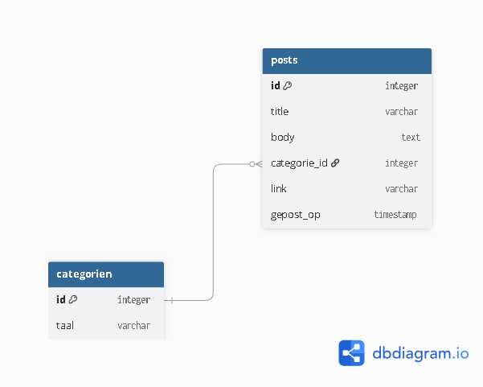

# Database Structuur

Versienummer : 1 
Auteur : Kenji Kapteijn 
Studentnummer : 0274085 
Klas : 25SDBb 
Datum : 28-9-2026 

## Versiebeheer

| Datum      | Versie | Wie      | Wijzigingen   |
| ---------- | ------ | -------- | ------------- |
| 2026-09-28 | 1.0    | Kenji K. | Eerste versie |
| 2026-09-28 | 1.1    | Kenji K. | DB Design Upd |
|            |        |          |               |

## Inhoudsopgave

- [Database Structuur](#database-structuur)
    - [Versiebeheer](#versiebeheer)
    - [Inhoudsopgave](#inhoudsopgave)
    - [De Database](#de-database)
        - [Waarvoor gebruikt Bitbin de database?](#waarvoor-gebruikt-bitbin-de-database)
        - [Welke data wordt er opgeslagen in de database?](#welke-data-wordt-er-opgeslagen-in-de-database)
        - [Ontwerp van Database](#ontwerp-van-database)
            - [Versie 1](#versie-1)

## De Database

### Waarvoor gebruikt Bitbin de database?

> De database wordt gebruikt om verschillende dingen op te slaan, het is beter om dit te doen in een database in plaats van lokaal (via bijvoorbeeld cookies of sessions) aangezien we het dan altijd terug kunnen halen van uit de database.

### Welke data wordt er opgeslagen in de database?

> Er wordt veel informatie opgeslagen in de database (refereer naar afbeelding hieronder), we slaan posts op zodat ze altijd op de website te zien/te vinden zijn. Er zit geen vervaldatum op de posts, dit is besloten in overleg met de opdrachtgever. Er worden ook categorien gekoppeld aan de verschillende posts, hiermee kan een gebruiker op de website altijd filteren op de verschillende categorien om altijd tussen de juiste talen te navigeren.

### Ontwerp van Database

#### Versie 1

