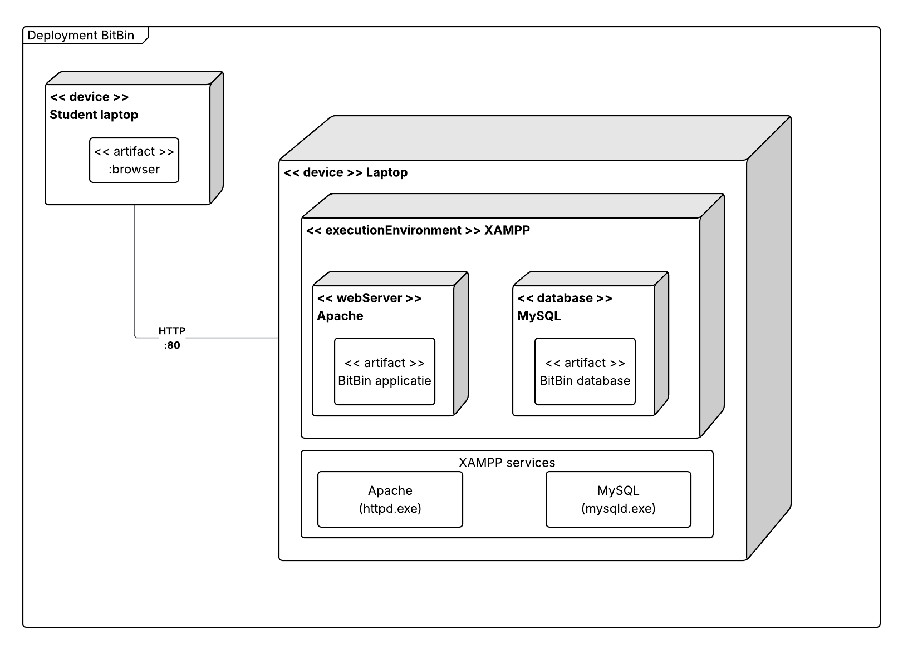
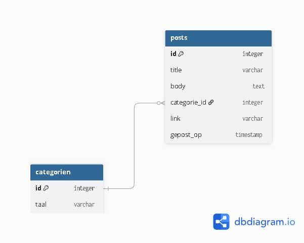
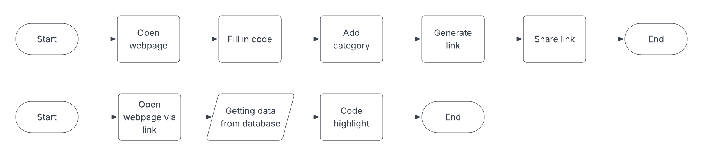
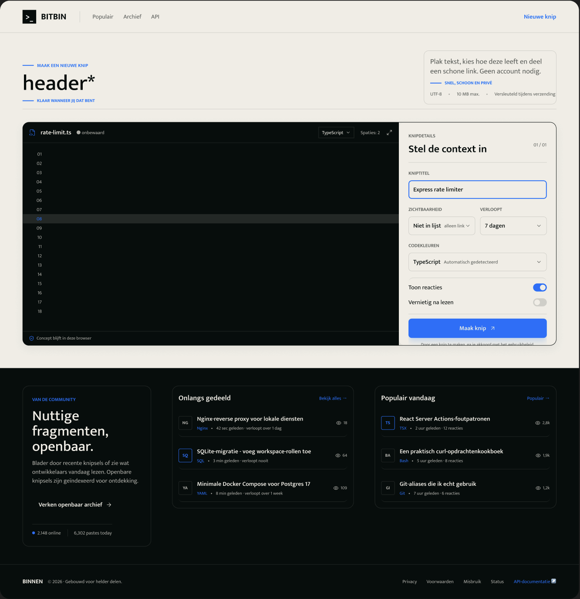

# Technisch Ontwerp

Versienummer : 1 
Auteur : Kenji Kapteijn 
Studentnummer : 0274085 
Klas : 25SDBb 
Datum : 25-9-2026 

## Versiebeheer

| Datum      | Versie | Wie         | Wijzigingen          |
| ---------- | ------ | ----------- | -------------------- |
| 2026-09-25 | 1.0    | Kenji K.    | Eerste versie        |
| 2026-09-25 | 1.1    | Christel E. | Toevoeging ontwerpen |
| 2026-09-25 | 1.2    | Kenji K.    | ERD Toegevoegd       |
| 2026-09-28 | 1.3    | Christel E. | Toevoeging ontwerpen |
| 2026-09-28 | 1.4    | Kenji K.    | Aanpassing ERD       |
| 2026-10-05 | 1.5    | Christel E. | Kleine aanpassingen  |

## Inhoudsopgave

- [Technisch Ontwerp](#technisch-ontwerp)
  - [Versiebeheer](#versiebeheer)
  - [Inhoudsopgave](#inhoudsopgave)
  - [Inleiding](#inleiding)
    - [Over dit document](#over-dit-document)
    - [Over het project en de opdrachtgever](#over-het-project-en-de-opdrachtgever)
  - [Applicatie Componenten](#applicatie-componenten)
  - [Ontwerp](#ontwerp)
    - [Ontwerp van gegevens](#ontwerp-van-gegevens)
    - [Progammalogica](#progammalogica)
    - [User Interface](#user-interface)
  - [Software \& Techniek](#software--techniek)
  - [Onderbouwing](#onderbouwing)

## Inleiding

### Over dit document

In dit document wordt inzicht gegeven over de verschillende technieken die gebruikt gaan worden tijdens het ontwikkelen van de applicatie.

### Over het project en de opdrachtgever

TotalCode B.V. is een software development bedrijf dat zich alleen bezighoudt met de allernieuwste technieken. Over deze technieken is vaak nog weinig te vinden op internet, daarom vinden ze het belangrijk dat kennis over deze technieken intern gedeeld wordt. Ze merken dat dit weinig gebeurt, omdat het lastig is om kennis en code met elkaar te delen. Veel bestaande oplossingen kunnen ze niet gebruiken omdat ze de code en kennis wel geheim willen houden.
Om het delen van code makkelijker te maken wil TotalCode B.V. graag een eigen variant van pastebin.com voor intern gebruik: de BitBin.

## Applicatie Componenten

_Figuur 1 - Deployment Diagram_

## Ontwerp

Er wordt veel informatie opgeslagen in de database (zie figuur 2), we slaan posts op zodat ze altijd op de website te zien/te vinden zijn. Er zit geen vervaldatum op de posts, dit is besloten in overleg met de opdrachtgever. Er worden ook categoriën gekoppeld aan de verschillende posts, hiermee kan een gebruiker op de website altijd filteren op de verschillende categoriën om de juiste code te vinden.

### Ontwerp van gegevens

_Figuur 2 - ERD_

### Progammalogica

_Figuur 3 - Flowchart_

### User Interface

Het nieuwe design is simpel en duidelijk, met een grote code-editor die meteen klaarstaat als je de website opent. Alle instellingen voor je code, zoals de gekozen programmeertaal en de verlooptijd, staan netjes aan de zijkant. Je kunt je code nu supersnel opslaan en delen via een duidelijke knop, zonder al te veel extra informatie.

## Software & Techniek

De gebruikte software voor dit project:
| Software | Version |
|----------|---------|
| XAMPP | 8.2.12 |
| Apache | 2.4.58 |
| MySQL | 8.2.12 |
| PHP | 8.5.6 |

Voor git hebben we de afspraak om voor elke feature een eigen branch aan te maken, wanneer de feature af is naar dev te mergen. Wanneer de merge goed gegaan is en de feature door elk teamlid goedgekeurd is, de branch dev naar main te mergen. Dit om te voorkomen dat er merge conflicts ontstaan met de main branch en de main altijd als hoofd branch voor demo's gebruikt kan worden.

## Onderbouwing

De gebruikte software is gekozen omdat dit de software is dat gebruikt wordt voor het maken van opdrachten uit Nexed. Met deze software zijn wij al bekend en gezien de tijdsduur is het leren en gebruiken van nieuwe software niet haalbaar voor ons.
